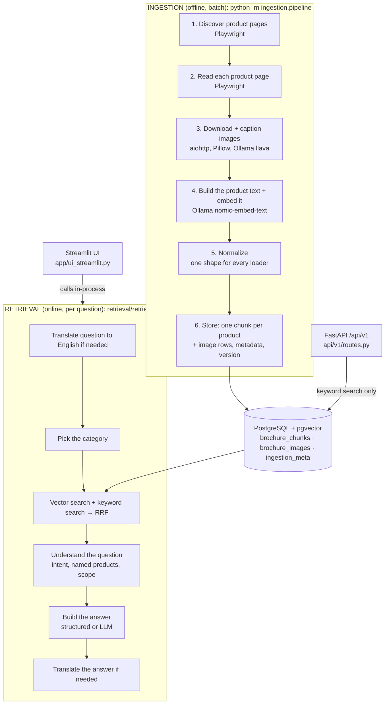

# How It Works: From Website to Answer

This walks through every stage of the project in the order data flows: where Playwright runs, where a page is read, where chunks and metadata are written, why normalization exists, how text and images are indexed differently, what retrieval does, and how the UI and the REST API connect to it.

File and function names are given as `path::function` so you can jump to the code.

---

## The big picture



Two halves share only the database:

- **Ingestion** is slow and heavy (browser, image downloads, vision model). It runs as a batch job, never inside a user request.
- **Retrieval** is fast and runs per question. It only reads the database and calls Ollama for embeddings, generation and translation.

---

## Part A: Ingestion

Entry point: `ingestion/pipeline.py::run_ingestion`. For each category it calls the category's loader, normalizes what comes back, fills in any missing embeddings, and stores it.

```
python -m ingestion.pipeline                         # all categories, incremental
python -m ingestion.pipeline --categories cars       # one category
python -m ingestion.pipeline --reset                 # wipe everything, rebuild, new major version
```

### Stage 0: Pick the version for this run

`metadata/metadata_store.py::next_metadata_version` / `reset`

Every run gets a version number that is stamped on every row it writes:

- A normal run gives a new minor version (v4.0 → v4.1).
- `--reset` gives a new major version (v4.0 → v5.0) and truncates both tables first.

The counter lives in the `ingestion_meta` table. The next number is the higher of that counter and any version already on a row, compared as numbers (`parse_version`), so a number is never reused.

### Stage 1: Discover product pages (Playwright)

| Category | Loader | Starts from | Keeps |
|---|---|---|---|
| cars | `loader/cars_loader.py::CarsLoader` | `tata.cars` home page | URLs shaped `/{model}/{energy}.html` (`_score_vehicle_url`) |
| motorcycles | `loader/motorcycles_loader.py` → `generic_loader.py` | `heromotocorp.com/en-in/motorcycles.html` | only `/en-in/motorcycles/...` (`_is_candidate_product_url`) |
| scooters | `loader/scooters_loader.py` → `generic_loader.py` | `heromotocorp.com/en-in/scooters.html` | only `/en-in/scooters/...` |
| spare_parts | `loader/spare_parts_loader.py` | Hero spare-parts shop | product links on the shop pages |

**Why Playwright:** these sites build their product lists and specs with JavaScript. A plain HTTP fetch returns a near-empty page. Playwright drives a real Chromium browser. It loads the page, waits, and scrolls (`_scroll_page`) so lazy content appears, then reads every link from the rendered page.

The browser lifecycle (launch → one page reused for every product → close) lives in `loader/base_loader.py::download_and_extract`. `CarsLoader` keeps its own version because of site-specific setup. `*_MAX_PRODUCTS` in `.env` caps how many product pages each category takes (5 today).

> The motorcycle/scooter mix-up came from this stage. The old rule accepted any link saying "BUY NOW", including the site-wide menu. It now accepts only the loader's own category path.

### Stage 2: Read each product page (Playwright)

`generic_loader.py::extract_product_page`, `cars_loader.py::_process_vehicle_page`, `spare_parts_loader.py::extract_product_page`

The loader opens each product URL and reads fields with CSS selectors:

- title / model name
- price
- description
- specifications
- features
- colour variants
- image URLs
- the full visible page text
- any JSON-LD block (`base_loader.py::_extract_json_ld`)

The result is one Python dict per product. Each loader uses its own field names; that's fixed in Stage 5.

> Known weakness: on Hero pages the price, image and description selectors pick the first match on the page, which is site-wide content. That's why Hero products share one price and the same pictures.

### Stage 3: Download and caption images

`base_loader.py::download_image` → `_image_record` → `process_image`

For each image URL on the product page:

1. Download it with `aiohttp`, size-capped, into a temp folder. Tiny, SVG and placeholder images are skipped (`_is_useful_image`).
2. Re-encode it to JPEG with Pillow (`embedding/embedder.py::_jpeg_base64`). CDNs serve AVIF/WebP under `.jpg` names, which Ollama rejects.
3. Caption it: Ollama `llava` describes the picture in at most 120 tokens (`Embedder.describe_image`, `VISION_MAX_TOKENS`).
4. Embed the caption: the caption text goes through `nomic-embed-text`. That vector is the image's embedding.

Vision can be turned off per category (`{CATEGORY}_ENABLE_VISION=false`), which makes ingestion much faster.

### Stage 4: Build the product text and embed it

`build_rag_document` in each loader

The extracted fields are joined into one readable text block, the **RAG text**, for example: `Brand: … Vehicle name: … Price: … Description: … Specifications: … Features: … Colors: …` followed by the page text.

That text is embedded once with Ollama `nomic-embed-text` into a 768-number vector (`base_loader.py::_ollama_embed`). If a loader returns no embedding, `pipeline.py::_embed_missing` fills it in.

### Stage 5: Normalize

`normalization/document_normalizer.py::normalize_document` → `NormalizedDocument`

**Why it exists:** the four loaders were written separately and name things differently (`model` vs `vehicle_name` vs `part_name`, `images` vs `image_results`, and so on). Without normalization, storage and retrieval would need a branch for every loader. Normalization maps every loader's dict onto one fixed shape:

```
NormalizedDocument
├── document_id      stable id: the same product always gets the same id across runs
├── category         cars | motorcycles | scooters | spare_parts
├── text             the RAG text
├── brand, model, price, description, features[], color_variants[]
├── product_url, source_type
├── text_embedding[] 768 numbers
├── images[]         NormalizedImage: relative_path, image_url, caption, embedding
└── extra{}          loader-specific fields that survive (e.g. vehicle_type)
```

It also persists each image (`images/image_store.py::PersistentImageStore.persist`). The file is copied from the temp folder into `data/<category>/images/` under a hashed filename, and stored with a path relative to `IMAGE_DATA_DIR`, so the database stays valid if the project folder moves. A broken image is dropped and logged; it never fails the whole document.

### Stage 6: Store: chunking, metadata and image rows

`metadata/metadata_store.py::upsert_documents` → `_upsert_document`

**Chunking is one chunk per product.** There is no splitting: each product's whole RAG text becomes one row in `brochure_chunks`, with `chunk_id = "{category}_{document_id}_0"`. A product is the unit people ask about, so one row per product keeps answers about one product together.

What one chunk row holds:

| Column | What it is |
|---|---|
| `text` | the RAG text (used for keyword search and as LLM context) |
| `text_embedding` | the 768-number vector (used for vector search) |
| `category` | used to filter every search |
| `metadata` (JSON) | brand, model, price, description, features, colours, product URL, images list, run id, version, content hash, token count, timestamp |
| `metadata_version`, `run_id`, `ingestion_timestamp` | which run wrote it |

**Metadata update.** The write is an upsert on `chunk_id`. Re-running ingestion replaces a product's row instead of adding a duplicate. Its image rows are deleted and re-inserted, so a re-run replaces images rather than appending them. Each product is written in its own savepoint: one bad row is logged and skipped, and the rest of the run continues. At the end, the version counter is saved to `ingestion_meta`.

**Indexes** (`_ensure_indexes`):
- HNSW vector index on `brochure_chunks.text_embedding`.
- HNSW vector index on `brochure_images.image_embedding`.
- B-tree indexes on `category` and `chunk_id`.
- There is **no** full-text (GIN) index: keyword search computes `to_tsvector` on every query, which is fine at this size.

---

## Text indexing vs image indexing

| | Text | Image |
|---|---|---|
| Source | the product's RAG text | a downloaded picture |
| How it becomes a vector | `nomic-embed-text` on the text | `llava` writes a caption, then `nomic-embed-text` on the caption |
| Stored in | `brochure_chunks.text_embedding` + `text` | `brochure_images.image_embedding` + caption and file path in `metadata`; the file itself in `data/<category>/images/` |
| Rows | one per product | up to `*_MAX_IMAGES_PER_PRODUCT` per product, linked by `chunk_id` |
| Keyword-searchable | yes (`text`) | no |
| Used at question time | **yes**: every search runs over these rows | **not searched today.** Image vector search was removed with the "Search type" toggle. Images are shown only as product cards, read from the chunk's metadata (`own_image`), and only when the filename matches the product |

Both vectors come from the same model, so they live in the same vector space. A picture is only as findable as its caption is accurate. There is no separate visual encoder.

---

## Part B: Retrieval (per question)

Entry point: `retrieval/retriever.py::retrieve_with_sources(query, category=None, top_k=5, language="English")` returns `(answer, rows)`.

### Step 1: Translate the question, only if it isn't English

`needs_translation` → `translate_query` (Ollama `MULTILINGUAL_MODEL`, e.g. `qwen3:8b`)

The database is English, so a German or Hindi question is first rewritten as one English line: "Welche SUVs haben ein Schiebedach?" becomes "Which SUVs have a sunroof?". English questions skip this.

### Step 2: Embed the question and pick the category

`search_in_category`

- The question is embedded with `nomic-embed-text`, the same model as ingestion, so the vectors are comparable.
- The category comes from category words in the question (`categories_in`), which tolerate typos: "motocycles" → motorcycles. With none, the top single vector match decides.
- Every later search is restricted to that category in SQL (`WHERE category = ANY(...)`), so cars never mix with scooters.
- Only the newest `metadata_version` is searched (`_latest_metadata_version`). Older rows are used only if the newest has nothing usable.

### Step 3: Hybrid search, then RRF

`_search_with_version` runs two searches at the same time:

| Search | Function | Finds | Good at |
|---|---|---|---|
| Vector | `search_similar` (pgvector HNSW) | rows whose meaning is close to the question | paraphrases: "SUV with a glass roof" ≈ "panoramic sunroof" |
| Keyword (BM25-style) | `search_keywords` (PostgreSQL `to_tsquery` / `ts_rank`) | rows containing the words | exact names and part numbers: "2830AKAG900S" |

**RRF (Reciprocal Rank Fusion)**, `rrf_fusion`, merges the two lists. Each row scores 1/rank in each list where it appears, summed. A row near the top of both lists wins. RRF uses only positions, so the two searches' different score scales never need calibrating. Rows are then de-duplicated per product (`unique_by(product_identity)`).

> RRF is **not** a reranker: it never reads the question against the document. A cross-encoder reranker would. It's on the roadmap and not implemented.

### Step 4: Understand the question

On the candidate rows:

- **Landing pages dropped:** rows with no real product name, such as the Hero home page, are removed (`name_words`).
- **Intent and named products:** `understand_query` labels the intent (comparison, price, table, colour, spec, general) and finds which candidate products the question names (`named_products`). Matching is full name first ("Glamour X" ≠ "Glamour X ABS") and tolerant of typos ("destiny" → Destini).
- **Scope check:** `is_automotive`. A question that names no product and uses no automotive word gets a fixed refusal in the chosen language, with no model call. "What is the capital of India?" is refused.
- **General questions:** "Explain details about tata automotive" names no product, category or feature, so it gets `catalog_overview`. That is one line naming the models plus each model's own description sentence, with no prices, images or model call.
- **Narrowing:** if the question names products, only those are kept, capped at `top_k`.

### Step 5: Build the answer

The first matching rule wins:

| Question looks like | Answer comes from | Model call? |
|---|---|---|
| names a product that isn't indexed ("Compare Altroz and Punch") | "**Punch**: not in the indexed catalog" + a table of the indexed ones (`unindexed_products`, `feature_table`) | no |
| compares features or colours | side-by-side table: linked name, price, colours, features (`feature_table`) | no |
| asks for a price or a table | `format_product_answer`. Products whose price is shared by several pages get the two-line "No reliable price … see the product page" note (`shown_price`) | no |
| asks which products have a feature ("Which SUV has a sunroof?") | list of products whose text mentions it, with the matching sentence (`feature_matches`, `feature_list`) | no |
| anything else | Ollama `GENERATION_MODEL` (`qwen2.5:1.5b`) writes the answer from a compact context of at most 800 characters per product (`product_context`, `generate_answer`) | yes |

Structured answers also get a **Details** paragraph per product, built only from that product's stored fields (`product_paragraph`). If the model call times out, a formatted list of the sources is returned instead (`fallback_answer`).

**Why so many answers skip the model:** the 1.5B model invented facts, such as specs for an unindexed Punch or the Altroz price for a sunroof question. When the answer can be built from stored data, it is.

#### Structured Product Answers in Detail

Before Ollama is called, the retriever runs through five decision gates in `retrieve_with_sources`. Each gate checks whether the question can be answered entirely from metadata already in the database.

```python
# Lines 686–697 in retriever.py
if missing:                    # Q names a product not in the catalog?
    answer = note + feature_table(...)  # Gate 1: unindexed products
elif (comparison and (spec or colour)):  # Q asks to compare specs/colors?
    answer = feature_table(...)         # Gate 2: feature table
elif (table or price) and not comparison:  # Q asks for table or price?
    answer = format_product_answer(...) # Gate 3: structured answer
elif matches and not comparison:        # Q asks which products have a feature?
    answer = feature_list(matches)      # Gate 4: feature list
else:
    answer = None               # Gate 5: none matched → use Ollama
```

**Gate 1: Unindexed products** (`unindexed_products`)
- Applies to: "Compare the Altroz and the Punch"
- Extracts product names from the question using splitting and fuzzy matching
- Checks which ones are missing from the retrieved rows
- Builds: `"**Punch**: not in the indexed catalog."` plus a table of the indexed products
- No model call needed

**Gate 2: Feature table** (`feature_table`)
- Applies to: "Compare features of Altroz, Curvv Series X" OR "Show me the specs" + comparison
- Builds a Markdown table: `Product | Price | Colours | Key features`
- Each row is one product; price and colours come from metadata, features from the first four stored
- Shared prices are marked "Not reliable (same price on several pages)"
- No model call needed

**Gate 3: Format product answer** (`format_product_answer`)
- Applies to: "Tell me the price of the Nexon" OR "Table of spare parts with prices"
- Builds either a Markdown table (if question names "table") or a bullet list
- For **price questions:** shows priced products in one section, then a two-line note for unpriced: `"No reliable price is indexed for [Part]. See the product page: [link]"`
- For **spare parts:** shows the part, price, and vehicle type (which vehicle it fits)
- No model call needed

**Gate 4: Feature list** (`feature_list`)
- Applies to: "Which SUV has a sunroof?" OR "What products have ABS brakes?"
- Searches for the feature term (from `feature_terms`, excluding stop words and generic words) in the text of each retrieved row
- For each match, extracts one sentence around the word using `relevant_snippets`
- Builds: `"- **[Harrier](url)**: The Harrier is available with a panoramic sunroof."`
- No model call needed

**If none of the five gates match,** `answer = None` and the retriever calls Ollama (line 703):

```python
if answer is None:
    try:
        answer = await asyncio.wait_for(
            asyncio.to_thread(generate_answer, query, context),
            timeout=65  # 60s for Ollama + 5s for Python overhead
        )
    except (RequestException, TimeoutError, asyncio.TimeoutError):
        logger.warning("Answer generation failed")
        answer = fallback_answer(query, unique_rows)  # ← Fallback here
```

#### Non-LLM Fallback on Timeout

If Ollama times out (after 60 seconds) or raises an error, the retriever does not return an error or an empty page. Instead, it falls back to `fallback_answer`:

```python
# Lines 611–616 in retriever.py
def fallback_answer(query: str, rows: Sequence[asyncpg.Record]) -> str:
    product_answer = format_product_answer(query, rows, as_table=wants_table(query), price_rows=rows)
    if product_answer:
        return product_answer  # If the question asks for price/table, build it without the model
    excerpts = [str(row["text"])[:400] for row in rows]
    return "The local answer model timed out. Retrieved source excerpts:\n\n" + "\n\n".join(excerpts)
```

The fallback is **two-tier:**

1. **If the question asked for price or table:** try `format_product_answer` (which needs no model). Show the table or the "no price" note instead of the generated answer.
2. **If the question is open-ended:** show the first 400 characters of each retrieved product's text, with a notice that Ollama timed out. The user sees real data, not "sorry, please try again".

Example: User asks "Tell me about the Nexon" but Ollama times out. Instead of an error:
```
The local answer model timed out. Retrieved source excerpts:

The Tata Nexon is a subcompact crossover...

Available in multiple color options...
```

**Why this design:**
- Local CPU-only Ollama can be slow (vision captioning takes 50s+). A hard timeout would lose answers that were almost ready.
- The fallback is deterministic: it never invents facts, only shows indexed data.
- For price and table questions, the fallback gives the same answer as the structured gate would have, so the user never sees the timeout.
- For general questions, the user sees **something** (the raw text) rather than nothing.

### Step 6: Translate the answer, only for non-English

`localize` → `translate_answer` (Ollama `MULTILINGUAL_MODEL`)

The finished English answer is translated. Product links are swapped for markers (`@@0@@`) before translation and restored afterwards, so names and URLs survive. If a marker is lost or the call times out, the English answer is shown with a warning.

---

## Part C: How the UI and the API connect

They are two separate front doors.

### Streamlit UI: the full RAG answer

`app/ui_streamlit.py` imports `retrieve_with_sources` and calls it directly, in the same process. There is no HTTP hop. It renders:

1. the **answer**,
2. a **Sources** list with product links,
3. **product cards**: the product's own image (if any) and an "Open product page" button.

Only the language and the number of results are chosen in the sidebar. The category is worked out from the question.

### FastAPI: product data, not generated answers

`api/__init__.py` builds the app; routes live under `/api/v1`:

| Endpoint | What it does | Uses |
|---|---|---|
| `POST /signup`, `POST /login` | create a user / get a JWT (bcrypt password hash, 24 h token) | `api_users` table |
| `GET /cars`, `/motorcycles`, `/scooters`, `/spare-parts`, `/products?category=` | list stored products of one category | plain SQL on `brochure_chunks` |
| `GET /search?q=` | keyword search, restricted to automotive questions | `retriever.search_keywords` + `is_automotive` (off-topic → 400) |

Every product route needs a `Bearer` token. The API does **not** run vector search, RRF, translation or the LLM; it returns product records. If you want the API to return the same answers as the UI, the change is one route that calls `retrieve_with_sources`. That route doesn't exist yet.

---

## Where each technology is used

| Technology | Stage | File |
|---|---|---|
| Playwright (Chromium) | discover + read product pages | `ingestion/loader/*_loader.py`, `base_loader.py` |
| aiohttp | download images | `base_loader.py::download_image` |
| Pillow | re-encode images to JPEG for Ollama | `embedding/embedder.py` |
| Ollama `llava` | caption images | `Embedder.describe_image` |
| Ollama `nomic-embed-text` | embed product text, captions and questions | `Embedder.embed_text` |
| PostgreSQL + pgvector | store chunks, images, vectors; HNSW search | `metadata/metadata_store.py`, `retriever.py::search_similar` |
| PostgreSQL full-text | keyword (BM25-style) search | `retriever.py::search_keywords` |
| Ollama `qwen2.5:1.5b` | write free-form English answers | `retriever.py::generate_answer` |
| Ollama `qwen3:8b` (`MULTILINGUAL_MODEL`) | translate questions and answers | `retriever.py::translate_query`, `translate_answer` |
| Streamlit | chat-style UI | `app/ui_streamlit.py` |
| FastAPI + JWT + bcrypt | REST API | `api/` |
| Docker, Helm, Kubernetes CronJob | deploy UI + API, schedule ingestion | `Dockerfile`, `deploy/helm/tata-rag/` |

---

## Common points of confusion

- **"Is ingestion part of answering?"** No. It runs before, on a schedule or by hand. A question only reads what the last run stored.
- **"Where does chunking happen?"** In `MetadataStore.upsert_documents`, and it's one chunk per product, not split by size.
- **"Why normalize if each loader already produces a document?"** So storage and retrieval read one shape and never need per-site code.
- **"Are images searched?"** Not any more. Their caption vectors are stored, but retrieval searches the text rows only, and images are shown as cards.
- **"RRF vs reranking?"** RRF merges two ranked lists by position. A cross-encoder reranker would score each question–document pair by reading both, and it isn't built.
- **"Does the API give the same answer as the UI?"** No. The UI runs the full retriever; the API returns product records and keyword search results.
- **"Why do motorcycle answers look thin?"** The Hero pages were stored with site-wide content (shared price, pictures and banner text), so there is little true detail to show. That needs the loader fix and a re-ingest.
